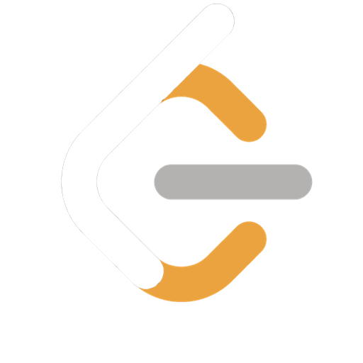

<!-- ═══════════════════════════════════════════════════════════════ -->
<!--           VIVEK KUMAR CHOUDHARY — GitHub Profile README       -->
<!--                     Updated: November 2026                    -->
<!-- ═══════════════════════════════════════════════════════════════ -->

<!-- ── HERO ──────────────────────────────────────────────────────── -->
<div align="center">

<h1>Hi, I'm Vivek Kumar Choudhary 👋</h1>

<a href="https://git.io/typing-svg">
  
</a>

<p><em>AI/ML Engineering Student · Microsoft Certified · AWS Student Builder Group Leader</em></p>

<p>
  <a href="https://www.linkedin.com/in/choudharyvivek1430/">
    
  </a>&nbsp;&nbsp;
  <a href="https://github.com/Vivek30092">
    
  </a>&nbsp;&nbsp;
  <a href="https://learn.microsoft.com/en-us/users/choudharyvivek1430/">
    
  </a>&nbsp;&nbsp;
  <a href="https://x.com/vivekkumarc934">
    
  </a>&nbsp;&nbsp;
  <a href="https://leetcode.com/Vivek3014/">
    
  </a>
</p>

<p>
  <a href="https://vivek30092.github.io/index.html">
    
  </a>
  <a href="https://drive.google.com/file/d/1cq_fHE8nTSSpvUZOc0idOq06n_dSMH2c/view?usp=sharing">
    
  </a>
</p>


</div>

---

<!-- ── ABOUT ME ────────────────────────────────────────────────── -->
## 👤 About Me

```yaml
name        : Vivek Kumar Choudhary
education   : B.Tech CSE (AI & ML) — Sri Aurobindo Institute of Technology, Indore
focus       : Artificial Intelligence · Machine Learning · Generative AI · Cloud Computing
community   : AWS Student Builder Group Leader — SAIT, Indore (Sep 2026 – Present)
currently   : Preparing for Microsoft DP-800 · Practicing DSA in C++ daily
              Exploring LLM Fine-Tuning, RAG, and AWS Cloud Architecture
interests   :
  - Generative AI & Large Language Models
  - LLM Fine-Tuning & Retrieval-Augmented Generation (RAG)
  - MLOps & GenAIOps
  - Data Engineering & Analytics (Microsoft Fabric)
  - AWS Cloud Computing & AI/ML Services
  - Python & C++ Development
  - Database Engineering
  - Problem Solving & Competitive Programming
status      : Open to internships, research collaborations, and AI/ML opportunities
```

---

<!-- ── CURRENT FOCUS ───────────────────────────────────────────── -->
## 🎯 Current Focus

> These are areas I am actively learning and building — presented honestly as ongoing development, not claimed expertise.

| Domain | What I'm Working On |
|--------|-------------------|
| ☁️ **AWS & Cloud Computing** | Exploring AWS services, cloud architecture, AI/ML deployments, and infrastructure through hands-on projects |
| 🧮 **Data Structures & Algorithms** | Daily DSA practice in C++, improving algorithmic thinking and problem-solving skills |
| 🤖 **LLMs & Generative AI** | Learning LLM fine-tuning techniques, Retrieval-Augmented Generation (RAG), and practical GenAI applications |
| 📊 **Microsoft DP-800** | Preparing for the Microsoft Fabric Analytics Engineer Associate exam (data engineering and analytics) |

---

<!-- ── TECH STACK ──────────────────────────────────────────────── -->
## 🛠️ Tech Stack

### 💻 Programming Languages

<p>
  
  
  
  
  
</p>

### 🤖 AI, ML & Generative AI

<p>
  
  
  
  
  
  
</p>

### ☁️ Cloud & Data Platforms

<p>
  
  
  
  
  
</p>

### 🗄️ Databases

<p>
  
  
  
</p>

### 🌐 Web Development

<p>
  
  
  
  
</p>

### ⚙️ Tools & Environments

<p>
  
  
  
  
  
</p>

---

<!-- ── FEATURED CERTIFICATIONS ────────────────────────────────── -->
## 🏅 Featured Certifications

> Professional associate-level certifications most relevant to my AI/ML, data engineering, and cloud career direction.

<table>
<tr>
<td align="center" width="25%">

**🤖 MLOps Engineer Associate**
`Microsoft Certified`
`Oct 2026 – Oct 2027`

MLOps · GenAIOps · AI Operations · ML Infrastructure

[](https://learn.microsoft.com/en-us/users/choudharyvivek1430/)

</td>
<td align="center" width="25%">

**📊 Fabric Analytics Engineer**
`Microsoft Certified`
`Sep 2026 – Sep 2027`

Data Analytics · Semantic Models · Microsoft Fabric

[](https://learn.microsoft.com/en-us/users/choudharyvivek1430/)

</td>
<td align="center" width="25%">

**🔧 Fabric Data Engineer**
`Microsoft Certified`
`Jul 2026 – Jul 2027`

Data Engineering · Analytics Solutions · Monitoring

[](https://learn.microsoft.com/en-us/users/choudharyvivek1430/)

</td>
<td align="center" width="25%">

**✨ Generative AI Leader**
`Google Cloud Skills Boost`
`Sep 2026 – Sep 2029`

GenAI Applications · Responsible AI · Cloud AI Adoption

[](https://www.cloudskillsboost.google/)

</td>
</tr>
</table>

---

<!-- ── ADDITIONAL CERTIFICATIONS ──────────────────────────────── -->
## 📜 Additional Certifications & Programs

### 🎓 Technical Training & Nanodegrees

| Credential | Issuer | Issued | Focus |
|------------|--------|--------|-------|
| Future AWS AI Engineer Nanodegree | Udacity | Nov 2025 | AWS-based AI/ML development, model deployment |
| Mathematical Foundations of Machine Learning | NPTEL / IISc Bangalore | Apr 2026 | Linear algebra, probability, statistics, optimization |
| Stanford University — Code in Place | Stanford University | Jun 2026 | Python programming, problem-solving fundamentals |
| Python Programming with Red Hat (AD141) | Red Hat Academy | Jun 2026 | Python programming, scripting |
| Red Hat System Administration I (RH124) | Red Hat Academy | Mar 2026 | Linux system administration |

### 📋 Courses & Short Programs

| Credential | Issuer | Issued |
|------------|--------|--------|
| Neural Networks in Python: Deep Learning for Beginners | Udemy | Sep 2025 |
| Introducing Generative AI with AWS | Udacity | May 2025 |
| Google Cloud Gen AI Exchange Program | Google Cloud | Aug 2025 |
| Core and Advanced Java Internship | Ypsilon IT Solutions | May 2025 |
| Introduction to Cybersecurity | Cisco Networking Academy | May 2025 |
| Basics of Spanish Language and Culture-I (91%) | IGNOU / SWAYAM | Jan 2026 |


---

<!-- ── FEATURED PROJECTS ───────────────────────────────────────── -->
## 🚀 Featured Projects

<table>
<tr>
<td width="50%" valign="top">

### 🤖 AI & Machine Learning Projects
Hands-on ML and deep learning projects covering classification, regression, computer vision, and NLP tasks.

**Stack:** `Python` `TensorFlow` `PyTorch` `Scikit-Learn` `Pandas`

[](https://github.com/Vivek30092?tab=repositories)

</td>
<td width="50%" valign="top">

### ☁️ AWS & Cloud Projects
Practical cloud projects exploring AWS services, infrastructure setup, and cloud-based AI/ML application development.

**Stack:** `AWS` `Python` `Cloud Architecture`

[](https://github.com/Vivek30092?tab=repositories)

</td>
</tr>
<tr>
<td width="50%" valign="top">

### 📊 Data Engineering & Analytics
Data pipeline and analytics projects using Microsoft Fabric and related data platform tools.

**Stack:** `Microsoft Fabric` `SQL` `Python` `Data Pipelines`

[](https://github.com/Vivek30092?tab=repositories)

</td>
<td width="50%" valign="top">

### 🌐 Web Applications
Full-stack web applications with authentication, REST APIs, and database integration.

**Stack:** `Django` `Python` `MySQL` `PostgreSQL` `HTML/CSS`

[](https://github.com/Vivek30092?tab=repositories)
[](https://vivek30092.github.io/index.html)

</td>
</tr>
</table>

> 📌 **[Explore all repositories →](https://github.com/Vivek30092?tab=repositories)**

---

<!-- ── AWS COMMUNITY LEADERSHIP ───────────────────────────────── -->
## 🌩️ AWS Student Builder Group — Community Leadership

<table>
<tr>
<td valign="top" width="70%">

**Student Builder Group Leader**
**AWS Student Builder Group at Sri Aurobindo Institute of Technology, Indore**
*September 2026 – Present · Science and Technology*

Selected as an AWS Student Builder Group Leader, leading a student community focused on AWS technologies, cloud computing, and hands-on learning.

**Responsibilities include:**
- Organizing AWS-focused workshops, technical events, and learning sessions
- Helping students explore AWS and cloud computing through practical activities
- Building and supporting a student community at SAIT, Indore
- Coordinating a core team and collaborating with other student groups
- Publishing technical and community-focused content through AWS Builder Center
- Connecting students with AWS learning resources and the broader AWS community
- Coordinating event planning, promotion, and engagement

</td>
<td valign="top" width="30%" align="center">

[](https://www.meetup.com/aws-sbg-at-sri-aurobindo-institute-of-technology/)

[**Community Page →**](https://www.meetup.com/aws-sbg-at-sri-aurobindo-institute-of-technology/)

*Meetup: AWS SBG at Sri Aurobindo Institute of Technology*

</td>
</tr>
</table>

---

<!-- ── GITHUB STATS ────────────────────────────────────────────── -->
## 📊 GitHub Stats

<div align="center">


 


</div>

<div align="center">

<a href="https://git.io/streak-stats">
  
</a>

</div>

---

<!-- ── LEETCODE ────────────────────────────────────────────────── -->
## 🧩 LeetCode Stats

<div align="center">


</div>

---

<!-- ── CONTRIBUTION GRAPH ─────────────────────────────────────── -->
## 📈 Contribution Graph

<div align="center">

 


</div>

---

<!-- ── CONTRIBUTION SNAKE ─────────────────────────────────────── -->
## 🐍 Contribution Snake

<div align="center">

<picture>
  <source media="(prefers-color-scheme: dark)" srcset="https://raw.githubusercontent.com/Vivek30092/Vivek30092/output/github-contribution-grid-snake-dark.svg"/>
  <source media="(prefers-color-scheme: light)" srcset="https://raw.githubusercontent.com/Vivek30092/Vivek30092/output/github-contribution-grid-snake.svg"/>
  
</picture>

</div>

---


<!-- ── FOOTER ──────────────────────────────────────────────────── -->
<div align="center">


<p><sub>Vivek Kumar Choudhary · AI/ML Engineering Student · SAIT, Indore · Updated November 2026</sub></p>

</div>
